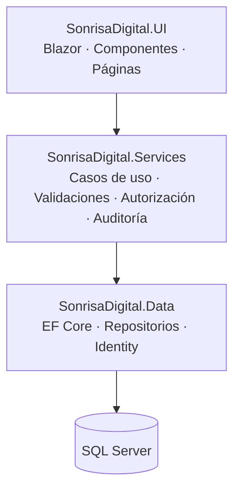

# Sonrisa Digital

**Sistema de gestión integral para clínicas dentales**

[](https://dotnet.microsoft.com/)
[](https://learn.microsoft.com/aspnet/core/blazor/)
[](https://www.microsoft.com/sql-server)
[](https://learn.microsoft.com/ef/core/)
[](#licencia)

Sonrisa Digital centraliza la operación clínica y administrativa de una clínica dental en una sola aplicación web: pacientes, odontólogos, citas, historia clínica, odontograma, tratamientos y pagos, con control de acceso granular y auditoría de actividades.

---

## Tabla de contenido

- [Descripción general](#descripción-general)
- [Funcionalidades](#funcionalidades)
- [Roles y permisos](#roles-y-permisos)
- [Arquitectura](#arquitectura)
- [Tecnologías](#tecnologías)
- [Requisitos](#requisitos)
- [Instalación y configuración](#instalación-y-configuración)
- [Primer acceso](#primer-acceso)
- [Seguridad en producción](#seguridad-en-producción)
- [Documentación](#documentación)
- [Hoja de ruta](#hoja-de-ruta)
- [Versionado](#versionado)
- [Licencia](#licencia)
- [Contacto y soporte](#contacto-y-soporte)

---

## Descripción general

Sonrisa Digital está diseñado para el **personal interno de la clínica** (administración, recepción y odontólogos). No incluye, por ahora, un portal para pacientes.

**Problema que resuelve**

- Información dispersa entre hojas de cálculo, agendas y registros en papel.
- Falta de trazabilidad sobre quién consultó o modificó información clínica.
- Dificultad para conocer citas del día, tratamientos en curso y saldos pendientes.

**Propuesta de valor**

- Una única fuente de verdad para la operación diaria.
- Acceso basado en roles y permisos, no en "confianza".
- Registro automático de actividades para auditoría.
- Interfaz web sin instalación en los equipos de la clínica.

---

## Funcionalidades

### Módulos implementados

| Módulo | Descripción | Estado |
|---|---|---|
| **Dashboard** | Indicadores de pacientes y odontólogos activos, citas del día, actividad reciente y saldo pendiente. | ✅ |
| **Pacientes** | Registro, búsqueda, edición, detalle y activación/desactivación de pacientes. | ✅ |
| **Odontólogos** | Gestión del personal odontológico y su información profesional. | ✅ |
| **Citas** | Programación, consulta, edición, cancelación y atención de citas. | ✅ |
| **Historia clínica** | Registro y consulta de información clínica por paciente. | ✅ |
| **Odontograma** | Odontograma interactivo con catálogo de hallazgos dentales. | ✅ |
| **Tratamientos** | Catálogo y registro de tratamientos asociados al flujo clínico. | ✅ |
| **Pagos** | Registro de pagos, historial y control de saldos pendientes. | ✅ |
| **Usuarios** | Administración de cuentas, roles y estado de acceso. | ✅ |
| **Roles y permisos** | Asignación granular de permisos por rol (32 permisos en 11 módulos). | ✅ |
| **Auditoría** | Registro automático de operaciones y actividad reciente en el dashboard. | ✅ |
| **Centro de ayuda** | Guías, preguntas frecuentes, solución de problemas y contacto de soporte. | ✅ |
| **Reportes** | Reportes administrativos y clínicos básicos. | 🚧 En hoja de ruta |

### Capacidades transversales

- Autenticación con **ASP.NET Core Identity** (cookie, bloqueo por intentos fallidos).
- Autorización basada en **permisos** (`sonrisadigital.permission`), no solo en roles.
- Protección **antiforgery** en formularios y acciones sensibles.
- **HTTPS** obligatorio y **HSTS** en producción.
- Página 404 personalizada y manejo controlado de errores.
- Datos iniciales (roles, permisos, administrador y catálogo odontográfico) creados automáticamente al arrancar.

---

## Roles y permisos

Sonrisa Digital incluye tres roles predefinidos. Los permisos son configurables desde el módulo **Roles y permisos**.

| Módulo | Administrador | Recepcionista | Odontólogo |
|---|---|---|---|
| Pacientes | Total | Total | Consulta |
| Odontólogos | Total | Consulta | Consulta |
| Citas | Total | Total (excepto atender) | Consulta y atención |
| Historia clínica | Total | Consulta | Total |
| Odontograma | Total | Consulta | Total |
| Tratamientos | Total | Consulta | Total |
| Pagos | Total | Registrar y consultar | — |
| Usuarios | Total | — | — |
| Roles y permisos | Total | — | — |
| Auditoría | Total | — | — |
| Reportes | Total | Consulta | Consulta |

> Los roles son acumulativos: un usuario puede tener más de un rol y recibe la unión de sus permisos.
> Los permisos de **Reportes** ya existen en el catálogo; su interfaz está en la hoja de ruta.

---

## Arquitectura

Monolito modular organizado en tres capas, con dependencias unidireccionales:



**Principios**

- La UI **no** accede directamente al `DbContext`.
- La lógica de negocio y las validaciones viven en `Services`.
- El acceso a datos se encapsula en repositorios dentro de `Data`.
- La autorización se evalúa por permisos, no por nombres de rol.

### Estructura del repositorio

```text
SonrisaDigital/
├── src/
│   ├── SonrisaDigital.UI/          # Aplicación Blazor (punto de entrada)
│   ├── SonrisaDigital.Services/    # Lógica de negocio y casos de uso
│   └── SonrisaDigital.Data/        # Entidades, DbContext, repositorios, migraciones
├── docs/                    # Visión, roles, módulos, modelo de dominio y arquitectura
├── SonrisaDigital.slnx             # Solución .NET
└── README.md
```

---

## Tecnologías

| Componente | Tecnología | Versión |
|---|---|---|
| Plataforma | .NET | 10.0 |
| Interfaz | Blazor Web App (Interactive Server) | .NET 10 |
| Persistencia | Entity Framework Core | 10.0.12 |
| Base de datos | Microsoft SQL Server | 2019+ / 2022 |
| Seguridad | ASP.NET Core Identity | 10.0.13 |
| Arquitectura | Monolito modular por capas | — |

---

## Requisitos

- **.NET SDK 10.0** o superior.
- **SQL Server** (Express, Developer o Standard) accesible desde el equipo.
- Herramienta **`dotnet-ef`** (solo para aplicar migraciones).
- Navegador moderno (Chrome, Edge, Firefox o Safari recientes).

---

## Instalación y configuración

### 1. Restaurar dependencias

```powershell
dotnet restore SonrisaDigital.slnx
```

### 2. Crear la base de datos

Crea una base de datos vacía llamada `SonrisaDigital` en SQL Server (SSMS, Azure Data Studio o `sqlcmd`). Las tablas se crean con las migraciones; **no** es necesario ejecutar scripts SQL manuales.

### 3. Configurar la cadena de conexión y el administrador

Para desarrollo, usa **user-secrets** en lugar de editar archivos versionados:

```powershell
dotnet user-secrets init --project src/SonrisaDigital.UI/SonrisaDigital.UI.csproj

dotnet user-secrets set "ConnectionStrings:DefaultConnection" `
  "Server=localhost;Database=SonrisaDigital;Trusted_Connection=True;TrustServerCertificate=True;MultipleActiveResultSets=True" `
  --project src/SonrisaDigital.UI/SonrisaDigital.UI.csproj

dotnet user-secrets set "Authentication:AdminEmail" "admin@tudominio.com" `
  --project src/SonrisaDigital.UI/SonrisaDigital.UI.csproj

dotnet user-secrets set "Authentication:AdminPassword" "CAMBIA-ESTA-CLAVE" `
  --project src/SonrisaDigital.UI/SonrisaDigital.UI.csproj
```

Ajusta `Server=` según tu instancia (por ejemplo `localhost\SQLEXPRESS` o `MI-SERVIDOR`).

### 4. Aplicar las migraciones

```powershell
dotnet tool install --global dotnet-ef   # solo la primera vez

dotnet ef database update `
  --project src/SonrisaDigital.Data/SonrisaDigital.Data.csproj `
  --startup-project src/SonrisaDigital.UI/SonrisaDigital.UI.csproj
```

Esto crea las tablas, relaciones, índices y las tablas de ASP.NET Core Identity.

### 5. Ejecutar la aplicación

```powershell
dotnet run --project src/SonrisaDigital.UI/SonrisaDigital.UI.csproj
```

También puedes iniciar el proyecto `SonrisaDigital.UI` desde Visual Studio o VS Code. La URL se muestra en la consola.

---

## Primer acceso

Al arrancar por primera vez, la aplicación crea automáticamente:

- Los roles **Administrador**, **Recepcionista** y **Odontólogo**.
- Los 32 permisos del catálogo y su asignación inicial.
- El usuario administrador definido en `Authentication:AdminEmail` / `Authentication:AdminPassword`.
- El catálogo base del odontograma.

Inicia sesión con esas credenciales y, de inmediato:

1. Cambia la contraseña del administrador.
2. Crea los usuarios reales de la clínica.
3. Revisa y ajusta los permisos por rol.

> Si la base de datos no existe o no tiene migraciones aplicadas, el arranque continúa pero el seeding se omite y se registra una advertencia en el log.

---

## Seguridad en producción

Antes de desplegar con clientes reales:

- [ ] Cambiar la contraseña del administrador inicial.
- [ ] Mover cadenas de conexión y credenciales a **variables de entorno** o un almacén de secretos.
- [ ] No versionar `appsettings.Development.json` ni archivos `.env`.
- [ ] Publicar únicamente sobre **HTTPS** y mantener **HSTS** habilitado.
- [ ] Usar un usuario de SQL Server con permisos mínimos (no `sa`).
- [ ] Configurar respaldos automáticos de la base de datos y probar la restauración.
- [ ] Revisar periódicamente la **auditoría** de actividades.
- [ ] Mantener actualizados .NET y los paquetes NuGet.
- [ ] Definir política de contraseñas y retención de datos clínicos.

---

## Documentación

| Documento | Contenido |
|---|---|
| [Visión y alcance](docs/01-vision-alcance.md) | Objetivos, alcance funcional y límites del sistema. |
| [Actores, roles y permisos](docs/02-actores-rolels.md) | Perfiles de usuario y reglas de autorización. |
| [Módulos y funcionalidades](docs/03-modulos-funcionalidades.md) | Comportamiento esperado de cada módulo. |
| [Modelo de dominio](docs/04-modelos-dominio.md) | Entidades, relaciones y reglas del negocio. |
| [Arquitectura](docs/05-arquitectura.md) | Capas, dependencias y decisiones técnicas. |

---

## Hoja de ruta

- [ ] Módulo de **Reportes** con filtros y exportación a PDF/Excel.
- [ ] Pantalla dedicada de **Auditoría** con búsqueda y filtros.
- [ ] Recordatorios de citas por correo o WhatsApp.
- [ ] Portal de pacientes (consulta de citas e historial).
- [ ] Soporte multi-clínica / multi-sucursal.
- [ ] Pruebas automatizadas y pipeline de integración continua.
- [ ] Despliegue con Docker e IIS documentado.
- [ ] Interfaz en inglés (i18n).

---

## Versionado

El proyecto sigue [Versionado Semántico](https://semver.org/lang/es/) (`MAYOR.MENOR.PARCHE`). Los cambios relevantes se documentarán en un `CHANGELOG.md`.

---

## Licencia

**Software propietario. Todos los derechos reservados.**

Este código se distribuye únicamente bajo autorización expresa del titular. Queda prohibida su copia, modificación, distribución o uso comercial sin un acuerdo por escrito. El uso del software por parte de clientes se rige por el contrato de licencia correspondiente (EULA).

---

## Contacto y soporte

- **Titular:** [Nombre del titular]
- **Correo:** [correo@tudominio.com]
- **Soporte:** [canal de soporte]
- **Sitio web:** [https://tudominio.com]

---

© 2026 Sonrisa Digital. Todos los derechos reservados.
